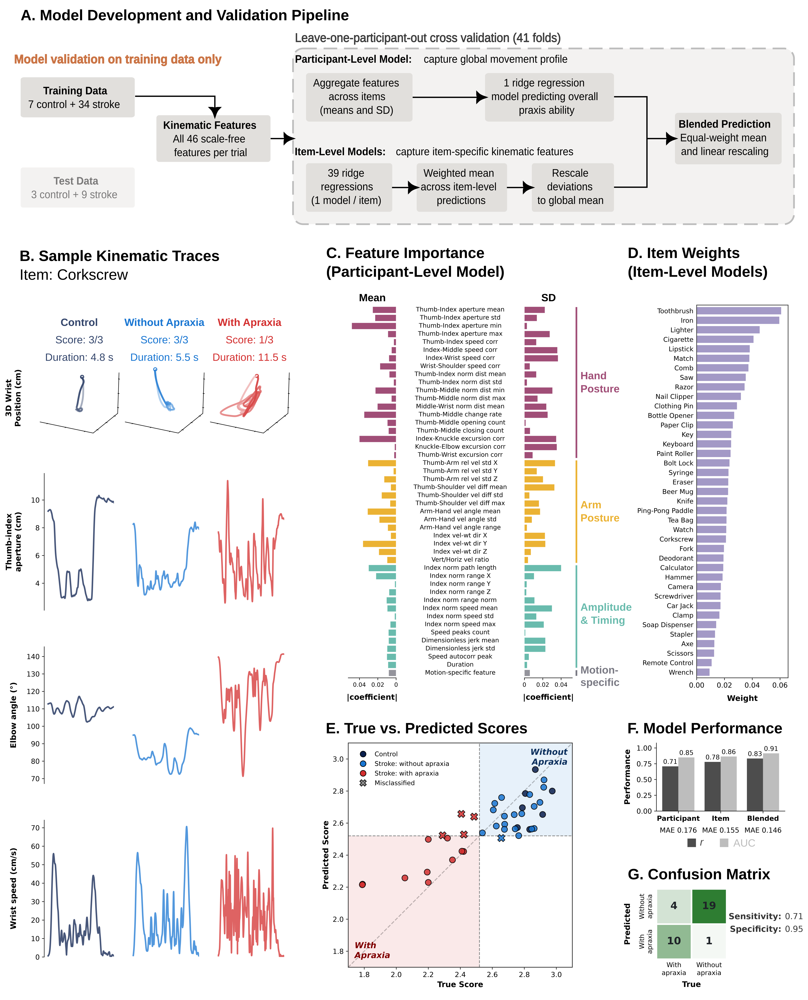

# Automated kinematic scoring of tool-use pantomime gestures in limb apraxia

**Daanish M. Mulla<sup>1</sup>, Laurel J. Buxbaum<sup>2,3</sup>, Aaron L. Wong<sup>2,3</sup>, & Jonathan A. Michaels<sup>1,4,5</sup>**  
<sup>1</sup>*School of Kinesiology & Health Science, York University, Toronto, ON, Canada* · <sup>2</sup>*Jefferson Moss Rehabilitation Research Institute &* <sup>3</sup>*Department of Rehabilitation Medicine, Thomas Jefferson University, Philadelphia, PA, USA* · <sup>4</sup>*Centre for Vision Research &* <sup>5</sup>*Centre for Integrative and Applied Neuroscience, York University, Toronto, ON, Canada*

[](https://neural-control-and-computation-lab.github.io/tool-pantomime-paper/)
[](reproduce.py)
[](LICENSE)

This repository provides the de-identified 100 Hz electromagnetic motion-capture dataset, kinematic feature-extraction and Ridge modelling pipeline, publication figure scripts, and **live interactive companion website** for *Automated kinematic scoring of tool-use pantomime gestures in limb apraxia*.

---

## Interactive Companion Website & Live Model Sandbox

> **[Open the Interactive Explorer (`neural-control-and-computation-lab.github.io/tool-pantomime-paper`) &rarr;](https://neural-control-and-computation-lab.github.io/tool-pantomime-paper/)**

Explore all **1,950 trials**, **53 participants**, **46 scale-free kinematic features**, and **39 everyday tools** directly in your browser—no installation required:

| Interactive Module | What You Can Do Live in the Browser |
| :--- | :--- |
| **[1. Combined Model & Feature Sandbox](https://neural-control-and-computation-lab.github.io/tool-pantomime-paper/#sandbox-section)** | Run the exact two-pathway Ridge `BlendModel` live across `N = 53` LOPO, `n = 41` training LOPO, or `n = 12` held-out test participants. Toggle individual kinematic features, motor families, or tool batteries (e.g., *Top 8 Features Only*, *Compact 12-Tool Clinical Screening*, *Hand Posture Only*), drag the **Participant ↔ Item pathway blend slider**, vary $\alpha$, and adjust the `2.52` apraxia cut-off. |
| **[2. Participant Contribution Inspector](https://neural-control-and-computation-lab.github.io/tool-pantomime-paper/#inspector-section)** | Click any participant on the scatter plot to decompose their predicted score into signed kinematic feature contributions ($\beta_{\text{mean}} z_{\text{mean}} + \beta_{\text{SD}} z_{\text{SD}}$) and per-tool item predictions vs. manual coder ratings. |
| **[3. 3D Pantomime Kinematics Viewer](https://neural-control-and-computation-lab.github.io/tool-pantomime-paper/#traces-section)** | Rotate 3D wrist, index, and thumb trajectories (*Corkscrew*, *Hammer*, *Lipstick*, *Scissors*) across a healthy control, a stroke patient without apraxia, and a stroke patient with apraxia, with a synchronized play/scrub cursor tracking thumb–index aperture, elbow angle, and wrist speed. |
| **[4. 39-Tool Battery Atlas & Figures](https://neural-control-and-computation-lab.github.io/tool-pantomime-paper/#atlas-section)** | Compare manual apraxia AUC, cross-validated kinematic AUC, learned reliability weights, and standardized manual coding criteria across all 39 tools, and inspect full-resolution manuscript Figures 1–4. |

[](https://neural-control-and-computation-lab.github.io/tool-pantomime-paper/)

---

## Quick Start (Reproduce Everything Locally in Two Commands)

Requires **Python 3.10+** on Linux, macOS, or Windows (no external system libraries required):

```bash
pip install -r requirements.txt
python reproduce.py
```

Running `python reproduce.py` extracts all 46 scale-free kinematic features from the raw 100 Hz recordings in `modelinputs/`, prints every statistical table in the manuscript, and renders all four composite publication figures (`figures/fig1.png`–`fig4.png` at 350 DPI and editable `figures/figure1.svg`–`figure4.svg`).

### Optional Flags & Standalone Commands

```bash
python reproduce.py --stats-only   # Print all manuscript statistical tables without rendering figures
python reproduce.py --figure 2     # Render a single manuscript figure (1, 2, 3, or 4)
python reproduce.py --export-web   # Regenerate docs/data/explorer_data.json from raw kinematics

# Standalone modelling CLI:
python model.py                    # Training cohort LOPO cross-validation (n = 41)
python model.py --test             # Held-out test evaluation (n = 12, trained on n = 41)
python model.py --all              # Full-cohort LOPO cross-validation (N = 53)
python model.py --items            # List all 39 tool-use pantomime items and manual coding criteria
```

---

## Summary of Reproduced Manuscript Results

Across **53 participants** ($10$ healthy controls, $26$ left-hemisphere stroke patients without apraxia, and $17$ stroke patients with apraxia; **$1{,}950$ content-valid trials** across **$39$ tools**; clinical apraxia cut-off $< 2.52$ on a $0\text{--}3$ scale):

| Evaluation Split | Pathway | Pearson $r$ | MAE | Stroke ROC AUC | Sensitivity | Specificity |
| :--- | :--- | :---: | :---: | :---: | :---: | :---: |
| **Training LOPO ($n = 41$)**<br>*(7 control, 34 stroke; 14 with apraxia)* | Participant<br>Item<br>**Blended** | $0.709$<br>$0.779$<br>**$0.833$** | $0.176$<br>$0.155$<br>**$0.146$** | $0.850$<br>$0.864$<br>**$0.914$** | $0.71$ ($10/14$)<br>$0.57$ ($8/14$)<br>**$0.71$ ($10/14$)** | $0.80$ ($16/20$)<br>$0.95$ ($19/20$)<br>**$0.95$ ($19/20$)** |
| **Held-Out Test ($n = 12$)**<br>*(3 control, 9 stroke; 3 with apraxia)* | Participant<br>Item<br>**Blended** | $0.760$<br>$0.484$<br>**$0.776$** | $0.127$<br>$0.159$<br>**$0.123$** | $1.000$<br>$0.722$<br>**$0.889$** | $1.00$ ($3/3$)<br>$0.33$ ($1/3$)<br>**$0.67$ ($2/3$)** | $1.00$ ($6/6$)<br>$1.00$ ($6/6$)<br>**$1.00$ ($6/6$)** |
| **Full-Cohort LOPO ($N = 53$)**<br>*(10 control, 43 stroke; 17 with apraxia)* | Participant<br>Item<br>**Blended** | $0.757$<br>$0.766$<br>**$0.870$** | $0.149$<br>$0.158$<br>**$0.126$** | $0.898$<br>$0.885$<br>**$0.946$** | $0.82$ ($14/17$)<br>$0.59$ ($10/17$)<br>**$0.82$ ($14/17$)** | $0.85$ ($22/26$)<br>$0.96$ ($25/26$)<br>**$0.92$ ($24/26$)** |

---

## Repository Structure

```text
.
├── reproduce.py          # Single-command runner: reproduces all stats & Figures 1-4
├── model.py              # Self-contained 46-feature extractor, 39-item metadata, & BlendModel
├── requirements.txt      # Minimal Python package dependencies
├── plotting/             # Modular figure scripts (fig1.py-fig4.py) & SVG schematic composer
├── figures/              # Generated Figures 1-4 (.png & .svg) + vector schematic templates/
├── modelinputs/          # De-identified 100 Hz trial kinematics (1,991 .npy files + metadata.json)
└── docs/                 # Interactive GitHub Pages companion website
```

---

## Dataset Format (`modelinputs/`)

### `modelinputs/metadata.json`
A JSON list of $1{,}991$ recorded trials with fields:
- `trial_name`: Filename stem corresponding to `modelinputs/<trial_name>.npy` (e.g., `"trial0"`).
- `participant`: De-identified participant code (`CL*` = healthy control, $n = 10$; `ST*` = left-hemisphere stroke survivor, $n = 43$). Held-out test participants ($n = 12$) are listed in `TEST_PARTICIPANTS` in [`model.py`](model.py).
- `item`: Integer tool-use item ID (`1`–`39`; mapped to names, motion categories, and rubrics in [`model.py`](model.py)).
- `experiment`: Sub-study protocol code.
- `score`: Nested manual rating `[[content, HP, AP, AT]]`:
  - `content` $\in \{0, 1\}$: Recognizable target tool pantomimed (`0` and unscorable `NaN` trials are excluded from kinematic quality scoring, leaving $1{,}950$ valid `content = 1` trials).
  - `HP`, `AP`, `AT` $\in \{0, 1\}$: Binary accuracy ratings for **Hand Posture**, **Arm Posture and Trajectory**, and **Amplitude and Timing**. Their sum (`0`–`3`) is the trial praxis score, averaged across `content = 1` items per participant.

### `modelinputs/trial*.npy`
Movement-segmented $100\text{ Hz}$ electromagnetic motion-capture array (Ascension 3D Guidance trakSTAR; ipsilateral left upper limb) of shape `(T, 49)`:
- **Column `0`:** Time in seconds ($100\text{ Hz}$ sampling rate).
- **Columns `1:25`:** 3D sensor positions $(X, Y, Z)$ in metres for the $8$ landmarks in order:
  1. `Thumb` (distal dorsum of thumb) — cols `1:4`
  2. `Index` (distal dorsum of index finger) — cols `4:7`
  3. `Middle` (distal dorsum of middle finger) — cols `7:10`
  4. `Knuckle` (base of the second metacarpophalangeal joint) — cols `10:13`
  5. `Wrist` (midpoint of the dorsal surface of the wrist) — cols `13:16`
  6. `Elbow` (olecranon process) — cols `16:19`
  7. `Left Shoulder` (ipsilateral acromial process) — cols `19:22`
  8. `Right Shoulder` (contralateral acromial process) — cols `22:25`
- **Columns `25:49`:** Corresponding 3D sensor velocities $(v_x, v_y, v_z)$ in $\text{m/s}$ ($Z$ = vertical axis; $(X, Y)$ = horizontal plane).

---

## License

Released under the [MIT License](LICENSE).
